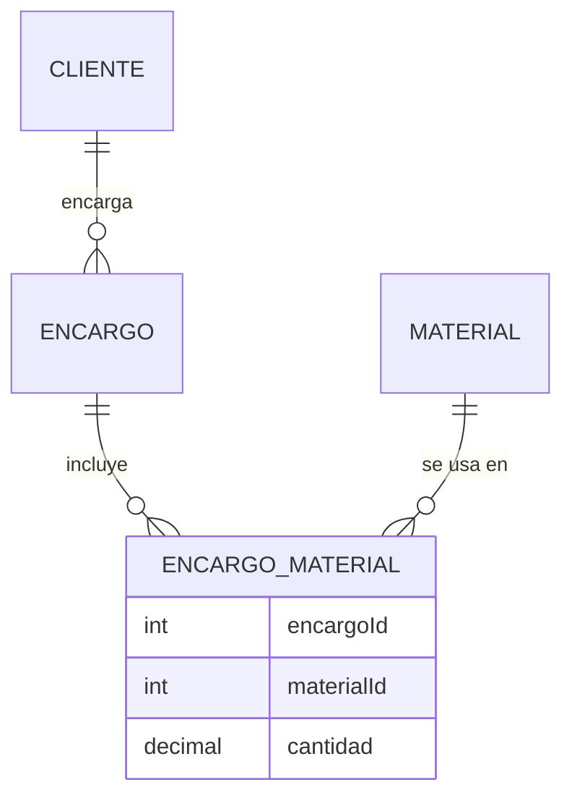
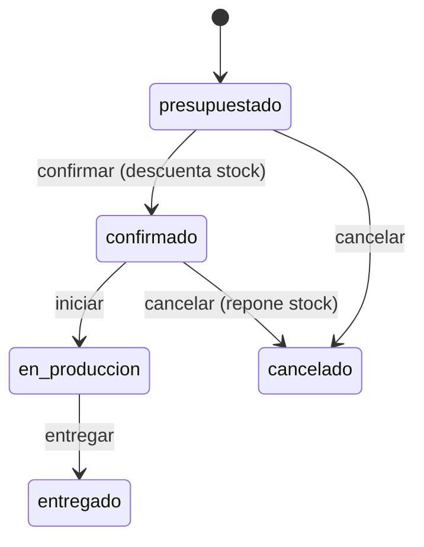

# ensamble-api

TP2 Proyecto Integrador — **Ensamble, Taller a Medida**.

API REST para un taller de fabricación a medida (carpintería / herrería), construida con arquitectura en capas.

## Dominio

- **Cliente** (1) — (N) **Encargo**
- **Encargo** (N) — (N) **Material**, a través de `EncargoMaterial { encargoId, materialId, cantidad }`
- Estados de un encargo: `presupuestado → confirmado → en_produccion → entregado`, o `cancelado`.
- Regla central: al confirmar un encargo se descuenta el stock de todos sus materiales de forma atómica; si falta stock responde `409 STOCK_INSUFICIENTE`.

### Cliente

Persona o empresa que encarga trabajos al taller. Recurso: `/clientes`.

| Campo      | Tipo            | Reglas                                                              |
| ---------- | --------------- | ------------------------------------------------------------------- |
| `id`       | entero          | Lo asigna el sistema; un `id` enviado en el body se ignora          |
| `nombre`   | texto           | Obligatorio, de 2 a 100 caracteres                                  |
| `email`    | texto           | Obligatorio, formato válido, **único**; se guarda en minúsculas     |
| `telefono` | texto o `null`  | Opcional, de 6 a 20 caracteres (dígitos, espacios, `+` o `-`)       |

- **Regla de negocio (caso de uso):** no puede haber dos clientes con el mismo email, sin distinguir mayúsculas, ni al crear ni al actualizar → `409 EMAIL_DUPLICADO`.
- **Actualización parcial:** `PUT /clientes/:id` modifica solo los campos enviados (al menos uno).
- **Listado:** `GET /clientes` acepta `nombre` (parcial), `email` (exacto), `sort` (`id`, `nombre`, `email`, con `-` para descendente) y `page` / `limit` (máximo 100). Ejemplo: `GET /clientes?nombre=ana&sort=-nombre&page=1&limit=10`.

### Material

Insumo del taller (madera, metal, herrajes). Recurso: `/materiales`.

| Campo         | Tipo    | Reglas                                                                    |
| ------------- | ------- | ------------------------------------------------------------------------- |
| `id`          | entero  | Lo asigna el sistema                                                      |
| `nombre`      | texto   | Obligatorio, de 2 a 100 caracteres, **único** (sin distinguir mayúsculas ni espacios en los extremos) |
| `unidad`      | texto   | `unidad`, `m`, `m2`, `kg` o `l`                                           |
| `stock`       | número  | `>= 0`, hasta 2 decimales, por defecto 0                                  |
| `stockMinimo` | número  | `>= 0`, hasta 2 decimales, por defecto 0                                  |

- **Regla de negocio (caso de uso):** nombre repetido al crear o actualizar → `409 MATERIAL_DUPLICADO`.
- **Listado:** `GET /materiales` acepta `nombre` (parcial), `unidad`, `bajoStock=true|false` (stock menor o igual al mínimo), `sort` (`id`, `nombre`, `stock`, con `-` para descendente) y `page` / `limit`.

### Encargo

Trabajo que un cliente le encarga al taller. Recurso: `/encargos`.

| Campo                  | Tipo                 | Reglas                                                        |
| ---------------------- | -------------------- | ------------------------------------------------------------- |
| `id`                   | entero               | Lo asigna el sistema                                          |
| `clienteId`            | entero               | Cliente existente; no se puede cambiar                        |
| `descripcion`          | texto                | De 3 a 500 caracteres                                         |
| `estado`               | texto                | Ver ciclo de vida                                             |
| `fechaEntregaEstimada` | `AAAA-MM-DD` o `null`| Opcional                                                      |
| `materiales`           | lista                | `{ materialId, cantidad }`, sin repetir material, cantidad > 0 con hasta 2 decimales |

Las respuestas incluyen `cliente: { id, nombre }` y cada material con su `nombre` y `unidad`.

### Relaciones



- **Cliente 1 — N Encargo** (`encargos.clienteId`).
- **Encargo N — N Material** a través de la tabla intermedia `encargo_materiales`, que guarda la `cantidad`.
- En Sequelize las asociaciones se definen juntas en `dao/models/index.js`.

### Ciclo de vida de un encargo



Cada transición es un endpoint: `PUT /encargos/:id/confirmar`, `/cancelar`, `/iniciar` y `/entregar`. Las transiciones permitidas están en un solo lugar: `usecases/encargos/estados.js`.

### Reglas de negocio

| Regla | Dónde | Error |
| ----- | ----- | ----- |
| Email de cliente único | `usecases/clientes/reglas.js` | `409 EMAIL_DUPLICADO` |
| Nombre de material único | `usecases/materiales/reglas.js` | `409 MATERIAL_DUPLICADO` |
| Confirmar descuenta el stock de **todos** los materiales en una operación atómica; si falta alguno no cambia nada | `usecases/encargos/confirmarEncargo.js` + `cambiarEstado` del DAO (transacción en Sequelize) | `409 STOCK_INSUFICIENTE` con el detalle por material |
| Cancelar un confirmado repone el stock | `usecases/encargos/cancelarEncargo.js` | — |
| Solo se edita un encargo presupuestado; solo se borra presupuestado o cancelado | `usecases/encargos/estados.js` | `409 ENCARGO_NO_EDITABLE` / `ENCARGO_NO_ELIMINABLE` |
| Acción que no corresponde al estado | `usecases/encargos/estados.js` | `409 TRANSICION_INVALIDA` |
| No se borra un cliente con encargos ni un material usado | `eliminarCliente.js` / `eliminarMaterial.js` (y FK `RESTRICT` en la base) | `409 CLIENTE_CON_ENCARGOS` / `MATERIAL_EN_USO` |

## Eventos y notificaciones

`confirmarEncargo` emite eventos en un bus (`EventEmitter`) creado en el contenedor. Los listeners de `listeners/registrarListeners.js` los convierten en avisos usando un **notificador** con interfaz `notificar({ asunto, mensaje })`, elegido por configuración. Cambiar de canal no toca la regla de negocio, y si un aviso falla el listener captura el error: la confirmación responde igual.

| Evento | Cuándo se emite | Qué hace su listener | Canal por defecto |
| ------ | --------------- | -------------------- | ----------------- |
| `encargo.confirmado` | Al confirmar un encargo | Avisa "Encargo confirmado" con el número, el cliente y la cantidad de materiales | consola (`NOTIFIER_ENCARGOS`) |
| `material.stockBajo` | Al confirmar, por cada material que queda con stock menor o igual a su mínimo | Avisa "Stock bajo" con el material, el stock que queda y el mínimo | archivo (`NOTIFIER_STOCK`, en `NOTIFICATIONS_FILE`) |

## Arquitectura

```
index.js → container/ → routes/ → controllers/ → usecases/ → dao/
```

| Carpeta        | Responsabilidad                                                     |
| -------------- | ------------------------------------------------------------------- |
| `config/`      | Único lugar que lee `process.env`                                   |
| `container/`   | Composition Root: arma dependencias y devuelve el router principal |
| `routes/`      | Definición de endpoints                                             |
| `controllers/` | Traducción HTTP ↔ casos de uso                                      |
| `usecases/`    | Lógica de negocio                                                   |
| `dao/`         | Acceso a datos: un DAO en memoria y uno Sequelize por entidad, con la misma interfaz; `daoFactory.js` elige cuál usar y `models/` define las tablas y sus asociaciones |
| `connection/`  | Crea la conexión Sequelize a SQLite                                 |
| `schemas/`     | Schemas de validación (Zod)                                         |
| `middlewares/` | `logger`, `validate`, `notFound`, `errorHandler`                    |
| `errors/`      | `AppError`                                                          |
| `events/`      | Nombres de eventos y creación del bus (`EventEmitter`)              |
| `listeners/`   | Qué aviso se envía ante cada evento                                 |
| `notifications/` | Notificadores (consola, archivo) y su factory                     |
| `docs/`        | Especificación OpenAPI y montaje de Swagger UI                      |

## Requisitos

- Node.js **22.22.3 o superior dentro de la 22.x, o 24.15.0 o superior dentro de la 24.x** (`^22.22.3 || ^24.15.0`). Lo exige Angular 22 para la interfaz web (`web/`); la API sola funciona desde Node 22.12 (lo exige Vitest 5).

## Instalación

```bash
npm run setup          # instala las dependencias de la API y de la interfaz web (web/)
cp .env.example .env
npm run dev:all        # levanta la API y la interfaz web juntas
```

Solo la API: `npm install` y `npm start` (o `npm run dev`, que reinicia al guardar).

| URL | Qué es |
| --- | ------ |
| http://localhost:4200 | Interfaz web (Angular) |
| http://localhost:3000 | API |
| http://localhost:3000/api-docs | Swagger UI |

`npm run dev:all` usa [`concurrently`](https://www.npmjs.com/package/concurrently): muestra la salida de los dos procesos con prefijo `[api]` y `[web]`, y si uno termina corta el otro. También se puede levantar cada parte por separado con `npm run dev` y `npm run dev:web`.

## Interfaz web

La carpeta [`web/`](web/) tiene una aplicación Angular 22 + PrimeNG, con su propio `package.json`, que opera la API sin cambiar sus contratos:

- **Encargos** (pantalla inicial): listado con filtros por estado y cliente, alta y edición con renglones de materiales y botones de ciclo de vida (Confirmar, Cancelar, Iniciar, Entregar) que solo aparecen cuando el estado los permite.
- **Clientes** y **Materiales**: listado con filtros y paginación, alta, edición y baja con confirmación; los materiales con stock bajo se marcan con una etiqueta.
- Los errores de la API (`409 STOCK_INSUFICIENTE`, `EMAIL_DUPLICADO`, validaciones, etc.) se muestran como avisos, y un indicador en la barra muestra si la API responde (`/health`).

**Proxy `/api`.** La interfaz llama siempre a `/api/<recurso>`; el servidor de desarrollo de Angular reenvía esos pedidos a `http://localhost:3000` quitando el prefijo (ver [`web/proxy.conf.json`](web/proxy.conf.json)). El prefijo evita que `/clientes` de la interfaz choque con `/clientes` de la API al recargar el navegador, y hace innecesario configurar CORS en la API.

**Tests del front.** Las reglas de presentación (`web/src/app/dominio/`), la traducción de errores (`core/errores/`) y los servicios HTTP (`core/api/`) tienen tests con Vitest + jsdom:

```bash
npm --prefix web test        # una corrida
npm --prefix web run build   # build de producción en web/dist/
```

## Variables de entorno

| Variable           | Valores                     | Por defecto   | Descripción                    |
| ------------------ | --------------------------- | ------------- | ------------------------------ |
| `PORT`             | número                      | `3000`        | Puerto HTTP                    |
| `NODE_ENV`         | `development`, `production` | `development` | Entorno de ejecución           |
| `PERSISTENCE_TYPE` | `memory`, `sequelize`       | `memory`      | Tipo de persistencia de la API |
| `DB_STORAGE`       | ruta de archivo             | `./ensamble.sqlite` | Archivo SQLite (solo con `sequelize`) |
| `DB_LOGGING`       | `true`, `false`             | `false`       | Muestra el SQL que ejecuta Sequelize |
| `NOTIFIER_ENCARGOS`| `console`, `file`           | `console`     | Canal del aviso "Encargo confirmado" |
| `NOTIFIER_STOCK`   | `console`, `file`           | `file`        | Canal del aviso "Stock bajo"         |
| `NOTIFICATIONS_FILE` | ruta de archivo           | `./notificaciones.log` | Archivo del canal `file`    |

## Cambiar de persistencia

La persistencia se elige con `PERSISTENCE_TYPE` en `.env` y **no requiere tocar rutas, controladores ni casos de uso**: el contenedor le pide los DAOs a `dao/daoFactory.js`, que devuelve los de memoria o los de Sequelize con la misma interfaz.

```bash
# En memoria (por defecto): cada arranque empieza sin datos
PERSISTENCE_TYPE=memory

# Base de datos SQLite: los datos se guardan en DB_STORAGE y sobreviven a los reinicios
PERSISTENCE_TYPE=sequelize
DB_STORAGE=./ensamble.sqlite
```

Reiniciá el servidor y comprobá el modo activo con `GET /health` (`"persistence": "sequelize"`). Las tablas se crean solas al arrancar. Si durante el desarrollo cambia el esquema de una tabla, borrá el archivo `.sqlite` para que se vuelva a crear.

Los tests HTTP de clientes y materiales corren **la misma suite en ambos modos**, que es la prueba de que responden igual.

## Endpoints

El detalle de todos los endpoints (parámetros, cuerpos, ejemplos y errores) está en Swagger UI: **`/api-docs`**. Acá solo los de infraestructura:

| Método | Ruta             | Descripción                                    |
| ------ | ---------------- | ---------------------------------------------- |
| GET    | `/health`        | Estado del servicio y persistencia configurada |
| GET    | `/api-docs`      | Documentación interactiva (Swagger UI)         |
| GET    | `/api-docs.json` | Especificación OpenAPI 3 en JSON               |

## Formato de errores

Todas las respuestas de error tienen la forma:

```json
{ "error": { "code": "NOT_FOUND", "message": "Ruta no encontrada: GET /no-existe" } }
```

`details` aparece solo cuando hay información adicional (por ejemplo, en `VALIDATION_ERROR`, como lista de `{ field, message }`).

## Tests

Los tests usan [Vitest](https://vitest.dev/) y [supertest](https://github.com/ladjs/supertest). No necesitan `.env` ni levantan un servidor: los tests HTTP arman la app con `createApp()` (en `app.js`) y persistencia en memoria.

```bash
npm test               # una corrida de toda la suite
npm run test:watch     # modo watch, vuelve a correr al guardar
npm run test:coverage  # corrida con reporte de cobertura en coverage/
```

```
tests/
  unit/        ← reglas de negocio y middlewares, sin base de datos ni process.env
                 (casos de uso en unit/usecases/<entidad>/<casoDeUso>.test.js)
  http/        ← endpoints de punta a punta con supertest (<entidad>.http.test.js)
  helpers/     ← builders y fábricas de datos de prueba (p. ej. buildTestApp)
```

`buildTestApp(options)` (en `tests/helpers/`) arma la app con `persistenceType: "memory"` por defecto; se le puede pasar otra opción para probar otro modo, por ejemplo `buildTestApp({ persistenceType: "sequelize" })`.

## Verificación manual

El archivo [`requests.http`](requests.http) tiene los pedidos de prueba (extensión REST Client de VS Code). También se pueden probar desde Swagger UI con *Try it out*.
